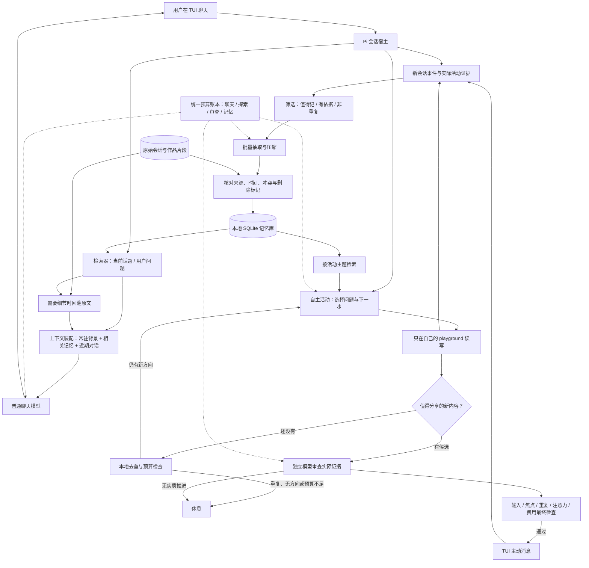
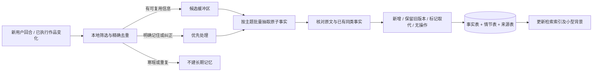

# Inner 长期记忆与主动发言：调研、结构设计和实施计划

调研日期：2026-11-03。基于当前 pi-config `8d4f72c` 的源码、既有合成接入证据、官方文档与论文。本文件是提案，未启用长期记忆、修改预算或执行新的付费模型实验。仅面向独立 TUI 聊天 demo。

建议采用：**有来源的结构化记忆 + 小量常驻背景 + 按需检索 + 可回溯原始片段**。先实现本地关键词/实体检索，再根据中文语义召回的实测缺口加入向量。压缩是写入环节，RAG 是使用环节，两者配合，不应二选一。不要把原始依据压缩丢弃，也不要先引入复杂的图数据库和多代理系统。

## 1. 总体结构图



图中的闭环由宿主控制，TUI 主动消息进入存档后不会自动启动下一轮聊天。记忆写入和检索结果本身也不能自动唤醒探索。继续探索需要当前活动链仍有效；新输入优先取消旧活动。图中“值得分享”是候选筛选，不能代替下游独立语义审查。

实现顺序上，先接记忆库而保持当前每步审查，再单独评估图中的按需审查优化，避免同时改两个核心行为而无法定位效果。

## 2. 当前记忆到底有什么

审查了 `assistants/inner/runtime.mjs`、`play-loop.mjs`、`persona.mjs`，以及共用 `caller.mjs` 和冻结的预算器。没有读取用户私人历史内容来建立档案。

| 当前载体 | 目前保存/使用的内容 | 不能提供的能力 |
|---|---|---|
| `sessions/*.jsonl` | 独立助手的当前会话，支持继续与重开 | 没有跨会话的事实检索索引；磁盘上存在不等于每轮自动召回 |
| `activity.json` 的 `progress` | 最近 6 条活动进展；演员请求取最后 4 条 | 是短摘要，不是用户知识库 |
| `activity.json` 的 `observations` | 最近 3 份实际观察，重启后恢复 | 更早作品可能不在上下文；与主题相关性无关 |
| `said` / `spoken` / `seen` / `content` | 最近发言、发送及动作/内容哈希去重 | 大部分用于避免重复，不支持“上次说过什么”的语义回忆；部分数组没有长期淘汰策略 |
| `playground/` | 草稿、故事、比较和简短思考记录 | 模型可通过文件工具读取，但没有统一的长期记忆筛选、检索与纠错 |
| persona | 自然对话与活动边界 | 当前每轮主聊天返回固定 persona，没有注入专门检索的用户记忆 |
| 旧 `memories.json` | 当前版不自动加载 | 不是已经工作的长期记忆模块，不应直接宣称可用 |

还存在两个影响连续性的细节：`next` 是活动链的局部变量，没有持久化成明确的未完成事项；`activity.json` 是 profile 级状态，但哪些信息是长期用户偏好、单次会话要求、某个作品设定，目前没有单独建模。

因此当前更接近“会话存档 + 很小的活动工作记忆”。要让它自然地延续话题，首要补的是**哪些事值得记、记的是谁的事、什么时候仍然有效、在什么话题下取出**。

## 3. 调研结论与技术取舍

### 3.1 压缩与 RAG 的关系

长期记忆的写入负责抽取、去重、合并和更新；RAG 负责在生成回复前取回相关内容。向量数据库只是检索的一种实现。对于当前 demo，SQLite 中的结构化事实、全文检索和少量原文回溯就可以形成 RAG，并不要求第一天就计算 embedding。

Mem0 的方法把记忆管理拆成抽取与更新阶段，并根据已有相关记忆决定新增、更新、删除或无操作。这支持“筛选后再放入”的方向，但本项目应把最终数据库修改权留给宿主，不能让模型随意覆盖全部记忆。其论文性能结论来自其特定实验，不能直接移植为本助手的体验承诺。[Mem0 方法原文](https://arxiv.org/html/2504.19413v1)

LightMem 将过滤、按主题整理与后续整合分开，启发我们把整理工作按材料积累和主题变化触发，减少每轮额外请求。这里借用分层和批处理思想，**不引入定时“睡眠任务”**。[LightMem，v4](https://arxiv.org/abs/2510.18866v4)

另一方面，2026 年对 LightMem 的复现指出：构造后的记忆不总比直接检索原始用户回合准确，压缩可能遗漏或改变回答所需信息；其优势受检索器和回答上下文预算影响。因此不能只保留一段越压越短的“人格总结”。本设计保留带来源的原子事实和可取回的原文，必须与原文检索基线比较。[复现研究，v2](https://arxiv.org/html/2607.29104v2)

LongMemEval 把长期对话记忆评估拆到信息抽取、跨会话推理、时间推理、知识更新与不知道时拒答，并讨论索引、检索和阅读三个环节。这是本计划把更新、来源、时间与“想不起来就不猜”纳入验收的依据；仅测“能搜到关键词”不够。[LongMemEval 原文](https://arxiv.org/html/2410.10813v2)

### 3.2 哪种存储适合这个 demo

| 方案 | 优点 | 代价/局限 | 建议 |
|---|---|---|---|
| 一个不断覆盖的总摘要 | 最简单、输入短 | 容易丢时间、否定词与来源；纠错困难 | 只用于短工作摘要，不作为唯一长期存储 |
| 结构化事实 + SQLite 词法检索 | 本地、可更新删除、来源清晰、无 embedding API 费 | 同义表达可能漏召回 | 第一版采用 |
| 结构化事实 + 词法/向量混合检索 | 能补充“蓄水/雨水收集”等语义差异 | 模型加载、索引版本、额外资源与评估工作 | 第二阶段有证据再接 |
| 全量历史直接放进长上下文 | 少一次抽取丢失 | 历史越长输入成本越大，噪音和旧信息更多 | 保留为小规模测试基线 |
| 图记忆/完整第三方记忆平台 | 多实体关系、服务化组件 | 对当前单用户聊天 demo 运维和语义复杂度较高 | 暂不引入 |

SQLite 需要特别处理中文。官方 FTS5 提供 unicode61 和 trigram 等 tokenizer；trigram 对短于三个 Unicode 字符的全文查询有局限，不能把它直接当完整中文方案。[SQLite FTS5 官方说明](https://www.sqlite.org/fts5.html#the_trigram_tokenizer)

本机做了**纯内存、无付费调用**的小检查：Node 22 的 `node:sqlite` 可以创建 FTS5 trigram 表；同一段文字里，MATCH“单材料”命中，MATCH“杯子”不命中。Node 同时提示该 SQLite API 为实验特性。它证明当前环境可做原型，不代表已完成持久化记忆适配。

第一版建议对中文生成单字/双字检索项、对英文保留单词，预分词后进入 FTS5，并对姓名、项目名、日期、两字短词增加精确字段匹配。检索项按程序转义，不把原始用户文本当 FTS 表达式。极短词可以在已过滤的小候选集内做精确匹配。保留 SQLite 驱动适配层，决定使用 `node:sqlite` 前固定最低运行版本并测试迁移；本轮不安装数据库依赖。

向量阶段可评估 BAAI 的 BGE-M3：作者模型卡说明其支持多语言及稠密/稀疏检索，可作为中文候选之一。但没有本机加载、延迟或内存实测，不能认定它适合这台机器，也不应为了几十条记忆直接加一个较重的常驻模型。[BGE-M3 官方模型卡](https://huggingface.co/BAAI/bge-m3)

## 4. 具体记忆结构

### 4.1 四层，各司其职

| 层 | 示例 | 是否常驻上下文 |
|---|---|---|
| 小型稳定背景 | 用户明确说“默认用中文”“只测 TUI” | 经作用域核对后常驻，初始约 100–200 tokens |
| 原子事实/偏好 | “当前 demo 不需要 GUI”；“从今天起喜欢稍详细的回复” | 相关话题下检索，通常 3–6 条 |
| 情节/作品记忆 | 哪次讨论排除了哪种杯子方案；门把手故事的触觉设定 | 按主题检索，保留作品身份 |
| 工作记忆/未完成事项 | 上次停在比较凹槽与双层壁，下一步验证哪个限制 | 当前主题使用，有状态，可结束或撤销 |

原始会话和作品是证据层，不是第五段必须一直塞进模型的长提示。工作摘要可以重建，不能反过来覆盖原始事实。

### 4.2 一条长期记忆的字段

```json
{
  "id": "mem_...",
  "kind": "preference",
  "subject": "user",
  "predicate": "preferred_response_style",
  "value": "平时简短；讨论方案时可以详细",
  "scope": {"profile": "inner", "topic": "conversation", "session": null},
  "assertion": "explicit_user_statement",
  "sources": [{"session_id": "...", "entry_id": "...", "quote": "..."}],
  "valid_from": "2026-11-03",
  "valid_to": null,
  "status": "active",
  "supersedes": null,
  "allowed_for_initiative": false,
  "revision": 1
}
```

`assertion` 是来源类别，不是模型自报的概率。可分 `explicit_user_statement`、`observed_assistant_artifact`、`unverified_inference`；最后一类不进入稳定用户事实。`valid_from` 是事实生效时间，另记录 `created_at/updated_at` 为数据库操作时间，二者不能混用。

涉及人、偏好、计划或作品时要区分 subject。助手写了“门把手听见争执”只能存为该虚构作品的设定，不能推成用户家里发生争执；助手自创的假设也不能在反复总结后变成用户经历。

### 4.3 筛选、压缩与更新



初始筛选优先：明确偏好、用户反复强调的约束、已确认决定、重要且有时间点的事件、持续项目状态、未完成的共同话题。寒暄、临时换句话说、没有执行的计划、没有依据的人格推断不自动进入稳定事实。

压缩保留“对象 + 内容 + 条件 + 时间 + 来源”。例如：

- 原文：“我平时不喜欢长篇回复，不过讨论方案时可以展开。”
- 合格记忆：“回复风格：一般简短；方案讨论可详细。来源：该用户回合。”
- 不合格记忆：“用户讨厌详细解释。”它把例外条件删掉了。

每批只处理新增事件，不反复总结全部历史。触发条件采用材料量、主题结束或明确“记住/纠正”意图，例如新增材料约 1,000–1,500 tokens 时做一次有预算的整理；这是缓存/成本阈值，不是探索步数或定时器。阈值需由小规模实测调整。

明确“记住这句话”可以先保存有出处的原文记录，不必等待批量压缩；模糊自动抽取进入候选区，不能在尚未核对时装作确定记忆。候选失败时保留来源并停下，不以多次重试换成功。

### 4.4 冲突、遗忘与删除

- 同一个 subject/predicate/scope 的新明确陈述可以取代旧值；保存版本与生效区间，回答历史问题时仍能解释当时的情况。
- 同时存在冲突而无明确取代关系时，保留冲突标记，检索结果不能只因“较新”就擅自选一个。需要时自然澄清。
- “这次请详细”只作用于当前回合/会话，不覆盖长期的“平时简短”。
- “忘掉我的地址”立即从可检索事实、向量、缓存和常驻背景移除，并取消相关待发送候选。保存最小删除标记阻止后续整理从旧来源重新抽取。
- 删除长期记忆与删除历史会话是不同操作。默认不破坏已有会话，但原文回溯也必须受删除标记过滤，不能绕路再次回忆。若用户要求连历史原文删除，单独列出并执行该范围。
- 删除与整理并发时，以数据库 revision 检查和事务提交为准。旧请求即使完成也不能覆盖删除后的状态。

为了保持 demo 简单，用户界面只增加一个 `/memory` 入口，里面可查看、纠正和忘记；自然语言“记住/更正/忘掉”是同一套操作，不新增一批模式。

## 5. 检索与注入，怎样既省钱又能记住

一次回复建议经过以下步骤：

1. 从当前消息、明确实体和正在延续的主题形成查询；第一版不用模型另写一遍查询。
2. 先过滤 profile、subject、topic、有效时间、删除状态和可用范围，再做关键词/实体检索。
3. 保留少量高相关、互不重复的结果；稳定背景按自己的小预算处理，不每次取全部库。
4. 用户问“当时具体怎么说”“为什么改主意”时回溯相应来源片段，而不是再总结一次摘要。
5. 把背景和结果作为有来源的数据放入上下文；不得把记忆文本提升成可修改系统规则的指令。
6. 整个主回复轮次使用同一份记忆快照，避免每次工具调用重新检索和改写前缀。

初始目标：常驻约 100–200 tokens，普通检索约 300–600 tokens，必要原文约 200–400 tokens，总量按回合上限截取。上述是设计起点，不是当前已达到的用量；如果证据装不下，优先保留来源事实，减少记忆条数，不截掉否定词和条件。

跨会话回忆在主聊天与自主探索中使用同一个 MemoryStore，但权限不同：普通聊天围绕当前问题取回；自主探索优先取自己的作品、开放问题和用户明确允许主动延续的话题。不能为了多发言就轮流翻私人事实找话题。个人事实可以帮助回答，不等于允许主动播报。

“记忆新写入”“检索到了旧内容”和“时间过去了”本身都不算新进展。要继续开口，仍要有新的问题推进或具体作品内容。

向量阶段将词法与向量候选作排名融合，再按来源与时效过滤；不直接比较两个不可比的原始分数。先不加每次都付费的 LLM 重排。向量只是加速召回的索引，可随模型版本重建，SQLite 中的事实和来源才是本地事实记录。

## 6. 当前预算的真正瓶颈

现有总上限：192 次调用、500,000 tokens、US$1。当前私有账本：119 次、50,434 tokens、保守 US$0.04668；剩余 73 次、449,566 tokens、US$0.95332。

**最先受限的是调用次数。** 每个有效动作通常需要一次演员请求 + 一次审查请求；有些请求用于读材料、选择沉默或失败，因此不能把一次调用等同一次主动发言。

按当前每次最坏输入预留 2048、输出 384，以及本机目录中的峰时输入/输出单价，单请求保守预留：

`2 × (2048 × 0.30 + 384 × 1.20) / 1,000,000 = US$0.0021504`。

73 次即使都按此最大预留也仅再占用约 US$0.15698，tokens 至多再预留 177,536；因此旧调用上限会在钱和 tokens 用完之前拦住。这个结论来自当前代码及账本，不是预测供应商账单。

还有三个独立限制，不是加钱就会改变：

- `unanswered <= 600` 是未回应主动文本上限，属于注意力控制。
- 单次输出 384 tokens 可能让长 JSON 截断，增加无效请求。
- 单次 2048 的输入上界实际采用 UTF-8/wire 字节保守估算，并非精确 tokenizer 计数，中文和 JSON 元数据会较早挤占空间。

更长的常驻记忆会使后两个问题更明显。不能一边加 RAG、一边仍把它硬塞进现有演员提示的剩余字节。

## 7. 当前价格与成本推演

截至调研日，DeepSeek 官方 Flash 每百万 tokens：峰时未命中输入 US$0.30、命中输入 US$0.006、输出 US$1.20；非峰时分别为 US$0.15、US$0.003、US$0.60。本机模型目录读到的峰时单价与官方页面一致。价格可变，因此新预算策略应记录价格版本，优先用峰时无缓存价格进行保守预留。[官方价格](https://api-docs.deepseek.com/quick_start/pricing/)

官方说明上下文缓存自动启用，基于已持久化的相同前缀，且属于 best effort，不保证命中。固定 persona、工具声明及背景的顺序，动态检索放在后段，有利于复用；不为缓存重复堆无用内容，也不把缓存当可恢复的长期记忆。[官方缓存机制](https://api-docs.deepseek.com/guides/kv_cache/)

以下**只是假设性工程测算，不是已实测提升**，使用本机已核对的模型目录单价，按峰时、完全无缓存计算：

| 请求 | 假设输入/输出 tokens | 供应商价格估算 |
|---|---|---:|
| 一次演员 | 1000 / 180 | US$0.000516 |
| 一次审查 | 800 / 100 | US$0.000360 |
| 一次批量记忆整理 | 1500 / 180 | US$0.000666 |
| 当前形态：每条有用消息需要 3 动作、每动作都审查 | 3 × 上面两种请求 | US$0.002628 / 条 |
| 优化假设：2 动作/条，平均一半动作需要独立审查 | 2 × (演员 + 0.5 × 审查) | US$0.001392 / 条 |

优化行必须仍确保每条待投递消息经过一次独立审查。“平均一半动作需要审查”不是给每个动作随机免检，也不是允许自我评分通过就发送。

据此，30 条有用主动消息/日的推演成本约为原形态 US$0.07884 或优化形态 US$0.04176，再加假设每天 10 批记忆整理 US$0.00666；普通用户聊天费用另计。这不保证达到 30 条，语义质量、沉默、失败、活动材料和注意力都可能限制数量。

真实已完成的小接入样例是 12 次循环请求产生 2 条主动消息；另 2 次独立语义审查不属于活动链。不能用一次成功样例预测长期转化率，更不能把历史累计费用除以总次数就声称未来每条固定成本。

主聊天的上下文会随会话增长，512 输出限制不限制其输入费用。目前实验账本不包含普通主聊天；若做长期预算，必须补齐主聊天输入、输出、缓存命中/未命中及未知费用，而不是只控制后台分支。

## 8. 让同样预算支持更多有价值的发言

按优先级建议这样做：

1. **先解除错误的资源瓶颈。** 不改历史冻结 `protocol.json`，把运行期预算策略从研究协议中分离。先保持总 US$1，建议将运行期累计调用上限从 192 调到 2048、tokens 上限调到 2,000,000；美元硬上限、历史支出和未知预留全部保留。这是提案，尚未应用。
2. **减少拿模型做可以本地完成的工作。** 文件读取、路径与内容哈希、精确重复和来源验证交给宿主；同一份记忆快照一轮只检索一次。没有候选的纯读取，不必再让模型花一次请求认定“文件被读到了”。
3. **审查集中在语义边界。** 暂存的低风险草稿可先经过本地边界/重复门继续，但标记未审查；出现待发消息、长期事实变更或不确定进展时，让独立审查器看实际差异。未审查草稿不能进入长期用户事实。审查否定时停止该分支，不继续洗出通过结果。
4. **让记忆服务内容质量。** 取回“上次没解决的问题”“已排除方案”和“已经说过的结论”，减少从起点重新读；同一候选里分享具体发现，而不是“我准备研究一下”。
5. **合并元数据与现有请求。** 让已有审查在证据允许时顺便返回一两条候选记忆，但宿主仍验证来源；不是每次都加一套“抽取→打分→再总结”的链。
6. **给输出留足结构空间。** 演员建议上限 512、审查 192、整理 384；提示保持短而具体，schema 减少重复的 question/expected/next 文案。提高某类输出额度不等于提高总费用上限。
7. **调整注意力，不机械加消息数。** 保留当前 600 未回应字符作为初始上限；让内容价值和连续话题决定是否再说。不要为了指标把一段回复切成几条。若以后调整注意力额度，应与花费额度分开评估。

条件审查会削弱“每个动作均有独立模型审查”的现有保证，因此只能作为第二阶段实验：先保持现状完成记忆，再同材料比较两种流程的无效推进、重复发言、总 tokens 与取消行为。未达质量阈值就保留每步审查。

## 9. 如需提升预算，怎样设计

推荐先做“不加钱的额度结构修正”，再进入日常使用额度。不要把 192 改成无限大，也不要清零旧账本。

| 提案 | 费用硬上限 | 辅助调用/tokens 护栏 | 用途 |
|---|---|---|---|
| 第一阶段：同费用扩容 | 仍是累计 US$1，继承已花 US$0.04668 | 累计 2048 请求、2M tokens | 完成记忆与效率验证，优先采用 |
| 第二阶段：日常小 demo | 背景活动+整理 US$0.10/日、US$3/月；另设累计授权 US$5 | 背景 400 请求/日、0.5M tokens/日 | 日常观察；任一额度触顶即停止背景分支 |
| 较高活动量，待后续选择 | 背景 US$0.30/日、US$9/月；累计授权 US$15 | 背景 1200 请求/日、1.5M tokens/日 | 在小额度实测质量稳定后才考虑 |

第二、三行是互斥的预算建议，不是用户模式，也没有在本轮启用。按上面的成本假设，US$0.10/日可以支持“几十条量级”的尝试空间，不构成条数承诺。按保守预留记账时，额度也可能更早触发。

主聊天继续由用户消息驱动，但显示在同一个花费面板，独立设置提醒/会话上限；只有用户明确设置整体上限时，才把两者放到同一个硬停条件。未决定主聊天额度前，不将 US$0.10/日描述为整个助手总价。

统一账本至少记录 `request_id, profile, purpose, model, tariff_version, reserved, reported_usage, priced_estimate, unknown, period`。purpose 区分 chat/explore/review/memory/embedding。请求前写入预留；已知 usage 按相应价格结算，未知消耗保留，不并发重复扣/释放。

历史“2 倍峰时价格保守账本”与未来“供应商 usage 估价”要分栏，不能迁移时突然把旧记录减半以制造更多余额。新日/月账本保存本地预算日期，累计授权额度不随日期变更清零；预算日期转换只在请求或用户交互时检查，不创建唤醒定时器。超额后保持普通可用界面，解释被哪个额度拦住，不自动升级模型或额度。

## 10. 文件与 Pi 框架接入设计

建议代码层保持少量职责清晰的文件：

| 模块 | 责任 |
|---|---|
| `assistants/inner/memory-store.mjs` | SQLite 表、事务、版本、来源、删除标记和迁移 |
| `assistants/inner/memory-policy.mjs` | 候选资格、主体/作用域、压缩输出核对、冲突与有效期 |
| `assistants/inner/memory-retrieval.mjs` | 中文检索项、实体/时间过滤、结果裁剪、未来向量适配 |
| `assistants/inner/context.mjs` | 常驻背景、检索结果及证据的上下文装配 |
| `assistants/inner/budget.mjs` | 独立运行期策略、分类账本、预留/结算和状态显示 |
| 现有 `runtime.mjs` | 事件连接、主聊天注入、TUI `/memory` 与预算状态 |
| 现有 `play-loop.mjs` | 取回开放问题、使用实际证据、按需审查实验与取消 |

运行数据建议为 profile 下 `memory.sqlite`、`memory-policy.json`、`budget-policy.json`，不放进模型可任意写的 playground。事实、情节、来源、版本/删除记录和检索索引分表，但先用同一个库。

Pi 1.4.0 的本机公开声明已核对：有 `context` 事件可替换本次请求 messages；`before_agent_start` 可以提供消息/系统提示。优先用 `context` 注入临时、带来源的数据，不向磁盘聊天记录每轮重复追加同一份记忆；保留固定 persona 的指令边界。具体 CustomMessage 转换和 SDK 压缩交互需要集成测试，不能仅凭有 hook 就声称已接通。

新会话恢复时：读库的有效版本、恢复未完成事项、按当前主题取回；不要自动重新导入所有历史。可迁移当前助手自己明确选择的会话，旧 coding-agent 资料、旧 memories 文件和其他私人目录不自动纳入。原冻结实验文件不改。

预算配置建议按 purpose 配不同的输入上界：演员保守 wire 上界 4096、审查 3072、整理 8192，并继续校验实际 payload；这些是用于预留的保守上界，不是要求每次填满的输入量。精确 tokenizer 可以后评估，初版保留可解释且有余量的保护。

## 11. 实施阶段与验收

以下为建议工序，不是已经完成的功能。先保证记忆正确，再追求更多发言；全程只用 TUI。

| 阶段 | 工作 | 产物与验收 | 新模型调用建议 |
|---|---|---|---|
| P0：预算与基线 | 分离运行策略；历史余额迁移；记录各类 usage；准备同义/冲突/作品例子 | 冻结 hash 不变；历史119次保留；并发和未知预留测试通过；普通聊天费用能单列 | 0，先复用现有证据 |
| P1：可解释的长期记录 | SQLite、来源、原子事实、显式记住/纠正/忘记；版本与删除标记 | 关掉重开/新会话后可查；临时要求不改长期偏好；删除后不可从旧摘要复活 | 先离线，最多约8次针对性抽取验证 |
| P2：轻量 RAG | 中文词法/实体/时间过滤；主聊天和活动链注入；按需原文回溯 | 不相关内容不注入；知道/不知道能区分；二字词可召回；作品不污染用户事实 | 最多约8次真实端到端 |
| P3：成本优化 | 批量整理、稳定缓存前缀、条件审查 A/B、短 schema | 每条消息仍有语义审查；单位有用消息调用数下降且重复/无依据不增加；否则回退每步审查 | 最多约12次小样例对照，不宣称统计显著 |
| P4：可选语义索引 | 仅词法召回确有缺口时评估本地/外部 embedding、混合排名 | 相同上下文预算下召回改善，记录本机占用/延迟；离线也能用词法 | 首先不花聊天调用，另报 embedding 资源 |

这最多28次新聊天模型调用的建议，不是本轮授权已经执行；如果不扩大调用上限，也能从剩余73次中安排。建议验证支出另设 US$0.10 保守上限并服从已有总 US$1，达到次数或费用任一限制就停。原48场景不重跑；若语义例子失败，保留失败而不是无限复测。

先做24个可控记忆用例，覆盖6组各4例：稳定偏好/条件；更新/时间；跨会话/指代；中文短词/同义；作品与事实；遗忘/取消/隔离。期望答案由用例明确定义，不由模型给自己打满意度分。然后在同一组输入下比较：近期上下文、原文检索、压缩事实检索、混合来源检索。

质量目标是设计验收值而非研究结论：关键约束/忘记/跨profile隔离必须全部正确；有答案用例 top-5 证据召回争取≥90%；不能回答的用例必须能保留不确定性；记忆数据不得变成系统指令。初版没达到时不增加复杂度掩盖错误，先修来源和检索。

真实 TUI 验收例子：

1. “以后默认简短，讨论设计时可以详细。”关闭重开后普通聊天简短，设计讨论不被错误截短。
2. “杯子只用一种材料，不能拆件。”换会话问“上次为什么没选外加套”，检索约束和决定，不重新猜。
3. 助手写门把手故事；问“你还记得我家发生什么了吗”，不能把故事当用户生活。
4. “忘掉刚才提到的住址。”随后追问住址不能从事实表、原文回溯、向量或待发消息拿回来。
5. 连续活动产生两个不同发现，中间没有用户输入，也能通过独立审查发两条；用户开始打字后迟到结果不可写入/发言。
6. 预算只剩一次请求、需要演员加审查时，不先做一个无法完成安全发送的半流程；要按最小可完成工作预留，或只本地保存草稿并停止。

花费效果报告至少展示：输入/输出/缓存、分类请求数、有效记忆数、相关证据召回、实际主动消息数、重复与无依据次数、每条有用消息成本、取消浪费。不把“消息更多”当唯一目标，也不将模型自评分标成人类喜欢。

## 12. 推荐的下一步

建议首轮只落地 **P0 + P1 + P2**：同 US$1 费用上限下修正调用限制，加入有来源、可更新、可忘记的 SQLite 长期记忆与轻量检索，保留当前独立审查。这样先解决真正的记忆缺口，同时为以后算清成本打基础。

之后再用 P3 判断“减少不必要审查”是否值得，而不是立即取消审查换取更多消息。只有词法检索在相同用例与预算下确实漏掉语义关联，再做 P4。整体仍然只有一个聊天助手，不增加一堆用户模式。
