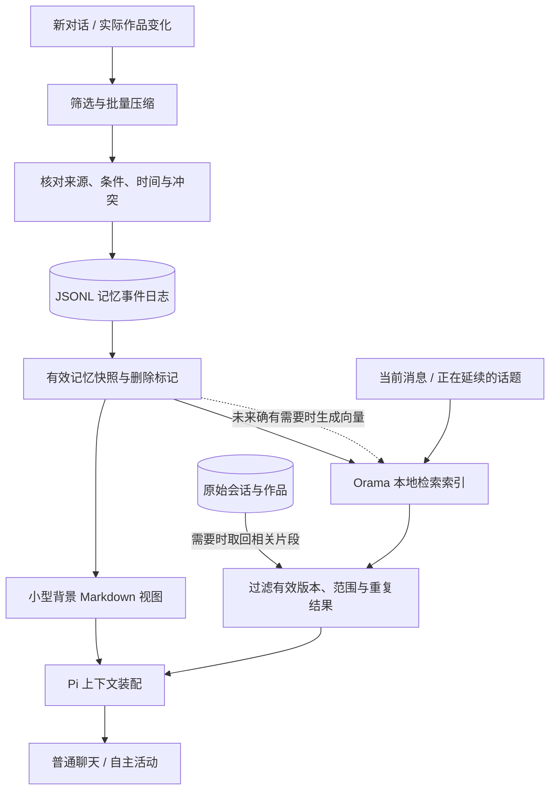

# Inner 轻量长期记忆：存储方案补充调研

日期：2026-11-03。补充此前的长期记忆/预算设计。用户希望采用更现代、轻量的方案；本轮仅查阅官方资料和 npm 发布元数据，没有安装运行依赖、改变助手行为或发起付费模型调用。

**修订建议：当前单用户 Node TUI 优先评估“文件化记忆 + Orama 嵌入式检索”；LanceDB OSS 作为后续向量检索需求增强时的备选。** 前一份设计里的来源、压缩、更新、忘记和预算原则继续保留，SQLite 不再是唯一或优先绑定的存储实现。

## 1. 代表项目现在采用什么

没有可靠的统一市场份额数据，因此这里只描述已核对的代表性路线，不把某个库称为全行业标准。

- **Letta：文件化记忆。** 当前官方文档将 MemFS 描述为 Git 支持的记忆文件系统，可跨会话使用。说明用文件组织长期上下文仍是活跃的现代方案。我们可借鉴文件化和可查看性，不照搬完整 Letta 运行时、远程同步或自动 Git 推送。[官方说明](https://docs.letta.com/configuration/memory)
- **Mem0：记忆管理层 + 可替换的存储。** 官方列出 Qdrant、pgvector 等多种后端；Node 的默认内存存储与显式配置的服务型后端部署方式不同。Mem0 不是某一种数据库，其完整栈还包括抽取模型、embedding 等，会引入额外调用和集成工作。[官方配置文档](https://docs.mem0.ai/open-source/configuration)
- **LanceDB OSS：嵌入式检索库。** 官方支持本地运行和 TypeScript SDK，覆盖向量、全文和混合检索。Node 安装会下载相应平台的原生库，无须据此引入独立数据库服务。[产品文档](https://docs.lancedb.com/)、[官方 Node SDK](https://github.com/lancedb/lancedb/blob/main/nodejs/README.md)
- **Orama：纯 TypeScript 检索引擎。** 官方仓库支持全文、向量和混合检索；适合直接嵌入现有 Node 进程。它不是替我们处理全部长期记忆语义的框架，也不应把索引快照当成完整的事务数据库。[官方仓库](https://github.com/oramasearch/orama)

前沿方案常把“记忆如何形成/更新”和“如何持久化/搜索”拆开。对本 demo，选择一个轻量检索库，不必同时更换 Pi 框架。

## 2. 面向这个项目的比较

以下轻重是部署和依赖结构判断，没有做实际 RSS/吞吐量基准。

| 方案 | Node TUI 部署 | 持久化方式 | 适用判断 |
|---|---|---|---|
| Markdown/JSONL + 简单程序检索 | 不加数据库进程或检索库 | 自有文件 | 规模很小时够用，中文检索与排名需自行实现 |
| **JSONL + Orama** | 同一 Node 进程，核心纯 TS | 原始记录可靠落盘，索引可重建/快照 | **当前轻量 demo 首选候选** |
| **LanceDB OSS** | 同进程嵌入，带平台原生库 | 本地 Lance 表 | 更强调向量数据、磁盘存储与检索能力时评估 |
| Qdrant + Node 客户端 | 在 Mem0 官方 Node 接法中连接独立 Qdrant 服务 | 服务端存储 | 未来多人共享、服务部署时评估 |
| Postgres + pgvector | 额外数据库服务 | 关系记录与向量统一管理 | 已有 Postgres 或明确需要多人事务时有吸引力 |

Qdrant 的 Python 本地模式不能直接等同于“Node 无额外服务”。是否需要进程、容器或托管服务，要按实际 SDK 核对。[Mem0 官方 Node/Qdrant 部署示例](https://docs.mem0.ai/open-source/configuration)

### 依赖体积的实际核对

通过 `npm view` 读取本次环境返回的发布元数据，**未安装**：

| 包 | 版本 | `dist.unpackedSize` |
|---|---:|---:|
| `@orama/orama` | 3.1.18 | 2,192,356 bytes，约 2.09 MiB |
| `@orama/tokenizers` | 3.1.18 | 34,723 bytes，约 33.9 KiB；依赖对应 Orama 核心 |
| `@lancedb/lancedb` JS 包 | 0.41.0 | 1,524,466 bytes，约 1.45 MiB |
| `@lancedb/lancedb-darwin-arm64` 原生包 | 0.41.0 | 262,343,368 bytes，约 250.2 MiB |

这些是发布包解包大小，不是压缩下载大小、完整安装大小或运行内存。不能只拿 LanceDB 的 JS 包大小比较；其 SDK 官方明确会获取平台原生库。Orama 的体积也不包含未来额外的 embedding 模型。npm 版本与仓库主分支可能不同，落地时固定实际验证过的发布版本。

元数据入口：[Orama](https://registry.npmjs.org/@orama%2Forama/3.1.18)、[中文 tokenizer](https://registry.npmjs.org/@orama%2Ftokenizers/3.1.18)、[LanceDB](https://registry.npmjs.org/@lancedb%2Flancedb/0.41.0)、[macOS ARM 原生包](https://registry.npmjs.org/@lancedb%2Flancedb-darwin-arm64/0.41.0)。

## 3. 修订后的结构



建议 profile 下的文件组织：

```text
memory/
  events.jsonl          # 记忆新增、修订、取代和删除事件
  checkpoint.json       # 已提交有效状态与日志位置
  core.md               # 从有效记录生成的小型背景视图
  search.snapshot       # 可丢弃、可重建的索引缓存
```

记忆事件仍使用上一份报告里的主体、条件、时间、来源和 revision。`core.md` 和 Orama 索引都是派生结果，不是另一套可以相互矛盾的事实来源。模型只提交候选，宿主核对并写入；记忆文件放在普通 playground 写工具范围之外。

这条路线在数据库依赖上轻，但持久化代码的责任更重，需要明确做好：

1. 沿用同 profile 单写者锁；记忆修改经串行队列提交，不能多个请求同时截断/重写日志。
2. 每条事件完整编码后追加并同步；尾部不完整记录不能当有效事件重放。为已确认提交设置明确的 durable 边界。
3. checkpoint 和索引缓存采用临时文件 + 原子替换；启动根据已提交日志恢复。压缩日志时保证快照、日志位置和版本匹配。
4. 先持久化事实变化，再更新检索索引；索引失败可以重建，不回退或丢弃已经确认的遗忘操作。
5. 每次返回检索结果都核对当前有效版本/删除标记。旧索引不能让已经忘掉的信息再次进入提示。
6. 大日志按实际大小进行事件驱动整理，不创建定时器。内存增长和启动重放耗时需要监测。

Orama 的官方持久化插件会序列化/恢复搜索状态；它不自动解决上述应用事件日志与索引之间的一致性。第一版可以直接用核心序列化接口，把索引当缓存，避免为几个编码格式增加依赖。[官方持久化实现](https://github.com/oramasearch/orama/blob/main/packages/plugin-data-persistence/src/index.ts)

## 4. 中文和向量怎么做到轻量

Orama 仓库中提供 Mandarin tokenizer，其实现使用 `Intl.Segmenter('zh-CN', {granularity:'word'})`，因此存在不用另起 Python 服务的中文分词路径。需核对所选发布版本并用我们的短词用例验证，不将源代码存在等同于本项目已验证命中率。[官方 Mandarin 实现](https://github.com/oramasearch/orama/blob/main/packages/tokenizers/src/mandarin.ts)

第一版：中文词法检索 + 实体/作用域/时间过滤 + 原文回溯。必须测“杯子”、人名、项目名以及条件句，不只测长段文字。

向量第二步接：

- Orama 提供向量搜索能力，但不会凭空生成好用的 embedding。模型要另选，算力/API 花费也单列。
- 记忆新增或正文变化才更新 embedding；正文相同的元数据变更不重算。
- 一次主回复使用固定检索快照；相同主题查询可按文本哈希、记忆库版本和 embedding 版本缓存。
- 删除记录同时过滤旧向量与缓存，不能因为命中向量就恢复旧事实。
- 暂不为了少量记忆常驻较大的本地 embedding 模型；先测词法缺口，再比较小模型本地推理和按需 API 的总成本。

这保留了通向混合 RAG 的接口，同时让第一版只有 Pi + 文件 + 一个小型 JS 检索库。

## 5. 下一步如何决策

建议先做一个隔离的 **Orama 适配小验证**，不接真实私人历史、不跑付费聊天实验：

- 用 200 / 2,000 / 10,000 条合成记忆测启动、检索延迟、RSS 增量和磁盘量；向量测试可用确定性假向量验证接口，但不能据此声称语义召回有效。
- 验证中文短词、条件、纠错、删除、索引丢失重建、半条日志和异步取消。
- 小规模下满足需求就采用；若内存、恢复流程或真实向量检索需求使它不合适，再以同一数据集对比 LanceDB OSS。

第一版仍保持每条消息独立语义审查与原 US$1 费用上限。存储库更换不自动增加有价值的发言；预算优化仍按前一份报告执行。

推荐采用的设计名称可以直接叫“文件记忆 + 本地混合检索”，用户依旧只看到一个聊天助手，无数据库管理界面或额外模式。
