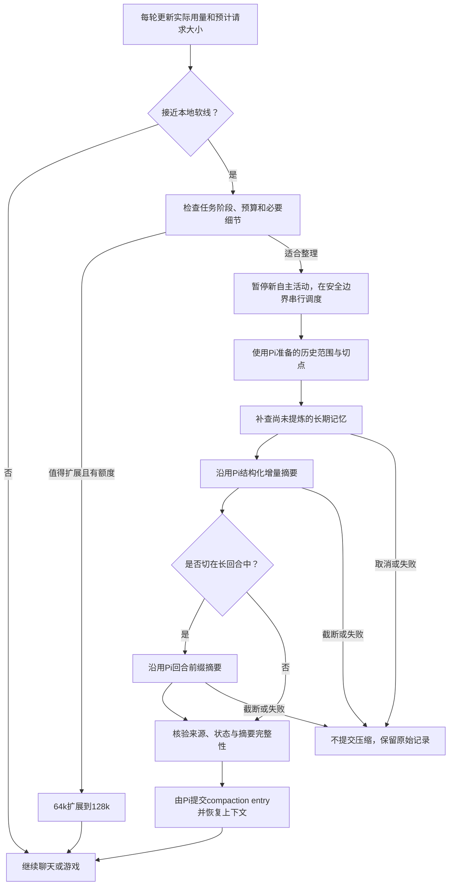

# Inner 压缩接入 plan：复用 Pi 原生机制，采用 64k/128k 上下文

日期：2026-11-03。本文覆盖此前总 plan 中的 12k/9k 上下文起点；采用用户最新希望的较大上下文。仅更新设计，不修改运行参数、模型或预算。实现仍只在 pi-config，界面仍为 TUI。

## 1. 决策

**不另写一套会话压缩器。** 保留 Pi 原生的准备、切点、结构化摘要、增量更新、compaction entry 和失败恢复流程；助手只增加本地上下文预算调度、压缩前记忆核对、分类费用和少量聊天/游戏摘要要求。

长期记忆与压缩继续分开：值得记的信息随事件写入；压缩时补查漏项；摘要服务当前对话延续，长期记忆服务跨会话检索。原始 JSONL 和作品状态保留，不因压缩被删除。

## 2. 已核对的 Pi 1.4.0 行为

以下结论来自本机安装源码与公开声明，不是推测：

- 原生自动触发条件是 `contextTokens > model.contextWindow - reserveTokens`。`reserveTokens` 是模型窗口预留，不是摘要长度，也不是本助手的费用上限。
- `keepRecentTokens` 控制切点附近希望保留的近期原文量，不等于压缩后整个请求长度；摘要、persona、工具声明和检索记忆还要另加。
- 原生切点不落在 tool result 上。可以保留一个完整近期区段，也支持在长回合中间切分，不保证一定只切完整用户回合。
- 若切在长回合中间，Pi 另外生成 turn-prefix summary，保留这次请求的来由。存在历史摘要与回合前缀两个调用，不能始终按一次压缩请求预留费用。
- 默认摘要是结构化的：Goal、Constraints & Preferences、Progress、Key Decisions、Next Steps、Critical Context，并追踪已读/修改文件。
- 已有摘要时，Pi 用旧摘要加新增消息更新，而不是每次从第一条聊天重新总结。
- 摘要因输出长度截断时，Pi 会拒绝保存这份不完整摘要。
- 只有成功后才追加 compaction entry 并刷新会话上下文视图。
- 手动 `session.compact()` 会先中止当前运行，不会自动续跑被中止的任务。因此自定义预算调度必须安排在安全边界，不能在模型正下棋或工具执行中随便调用。

主要核对文件：SDK `core/compaction/compaction.{js,d.ts}`、`core/agent-session.js`、`core/extensions/types.d.ts` 和顶层公开导出。后续只经公开 SDK/扩展接口接入，不 patch 核心文件。

## 3. 上下文容量与压缩节奏

| 项目 | 常规容量 | 必要时扩展容量 |
|---|---:|---:|
| 本助手请求输入上限 | 约64k | 约128k |
| 开始评估整理 | 约56k | 约112k |
| 接近上限时安排压缩 | 约60k，视当前阶段 | 约120k，视当前阶段 |
| 近期原文保留目标 | 约32k | 约64k |
| 历史摘要目标 | 约2–4k | 约4–6k |
| 压缩后的预期整包量级 | 约36–42k | 约70–78k |

这些是初始目标，不是每次固定填满或保证恰好压到某个数字。Pi 切点和真实消息大小会影响结果；必须核算摘要、工具定义、相关记忆与当前证据之后的实际总输入。

56k/112k 是“决定是否要整理或扩容”的软线，不是立刻付费压缩。若当前游戏或讨论仍强依赖最近过程、上下文较大有实际价值且费用足够，可以从64k自动扩展至128k；没有这种需要则在阶段边界整理。二者是同一助手的内部容量调度，不新增用户模式。

不伪造模型目录的 contextWindow，不把真实1M改成64k来误导其他组件，也不靠设置一个巨大的 reserveTokens 来伪装费用策略。由宿主在安全回合边界检查本地64k/128k预算，调用公开压缩入口；原生模型窗口触发/溢出恢复保留兜底，并做去重，不能两边同时总结。

输出空间、协议及估算误差另留余量。更换模型时按其真实窗口收紧，不默认任何模型都能提供128k。

## 4. 压缩流程

不在 `context` handler 中递归发起并同步等待压缩。该 hook 用于装配/检查；宿主把整理请求放到空闲/回合边界队列。新用户输入到达时取消旧整理或按最新事件重新排队，不把输入插进一个状态不明的压缩提交过程。

## 5. 摘要格式怎么适配聊天与游戏

保留 Pi 的主体格式，用 `customInstructions` 增加聚焦要求，第一版不替换整个原生生成器：

- Goal：当前聊天话题或活动方向；日常闲聊不强行解释为编程任务。
- Constraints & Preferences：用户原话中的限制、例外、偏好和当前适用范围。
- Progress：已实际发生的对话/操作、正在延续的内容、真实阻塞；不把设想写成已完成。
- Key Decisions：选了什么、为什么，以及哪些方案已被排除。
- Next Steps：尚未完成的问题或下一次合法活动；用户没有交代任务时可以为空。
- Critical Context：关键原文、日期、来源、文件/作品版本、未确认事项；游戏加入状态 ID 和校验值。

不加入私有推理轨迹，不把虚构故事变成用户经历，不将临时要求晋升为长期偏好。用户纠正和遗忘始终高于旧摘要；上下文装配时过滤旧记忆版本，不能因增量摘要“保留旧信息”而复活已经失效的内容。

摘要可以保留几个关键原句，但完整局面、作品、网页与工具输出保存在对应源中，需要时通过 read/检索取回。目标是保留可恢复的细节，不承诺总结完全无损。

## 6. 和长期记忆怎样衔接

使用 `session_before_compact` 获得准备信息与源分支，对将离开窗口且尚未扫描的 entry 范围做增量核对。只提炼有用事实、决定、条件及情节来源，不再把所有历史做一次全量摘要。

显式“记住/更正/忘掉”仍当轮优先完成，不等压缩。压缩前只是补查：

1. 按来源游标识别没处理过的记录。
2. 核对主体、作用域、时间及删除标记。
3. 持久化有效记忆和扫描进度，再允许 Pi 提交压缩。
4. `session_compact` 成功后记录对应 compaction entry、记忆版本与整理范围，更新当前工作状态。
5. `session_compact_failed`/取消则不改变上下文视图。已经成功落盘的事实可以保留，后续按来源去重。

优先让原生 Pi 生成并保存摘要，before hook 只完成记忆补查；摘要聚焦要求由宿主调用 `session.compact(customInstructions)` 时传入，不能假定 before hook 返回值可以修改该参数。不同时让 hook 返回另一份摘要又让原生重复生成。只有原生接口确实无法满足经过验证的需求时，才评估公开 `compact()` 结果扩展，并单独测试文件追踪与会话恢复。

## 7. 游戏的状态管理

64k/128k有助于保留策略、交流和历史，但不能替代游戏程序保存局面。

游戏引擎在受限执行进程中维护：`game_id`、规则版本、合法动作、当前状态、行动序号、随机种子及结果；每个成功动作保存可恢复状态。模型收到当前局面、相关近期动作和必要规则，提交动作后由引擎检查合法性。

压缩前后对照同一状态 ID/行动序号/校验值。摘要只描述策略、待解决问题和状态引用；不要求模型从文字摘要重新推演出唯一正确棋盘。

第一批以井字棋/2048或简单推箱子等可用规则程序验证的文字游戏为主，仍在TUI显示，不接GUI。游戏接入与压缩改造可分阶段，先用合成状态测试压缩不中断规则。

## 8. 必须先修的输出和费用路由

当前 `assistants/inner/runtime.mjs` 对主模型 `streamSimple` 统一做了 `maxTokens <= 512` 的包装。Pi 压缩会使用同一模型流，因此可能把本应完整的摘要截断；不能只把keepRecent改大就声称大上下文可用。

按用途分开预算：

| 用途 | 建议初始输出上限 | 说明 |
|---|---:|---|
| 普通聊天 | 维持512或按体验调整到1024 | 不与摘要绑死 |
| 64k容量的历史摘要 | 4096 | 目标完整、结构化；截断仍失败，不保存半份 |
| 128k容量的历史摘要 | 6144 | 同上；目标摘要不是每次必须写满 |
| 长回合前缀摘要 | 独立预留，初始约2048 | 原生分支可能另发一次请求 |
| 记忆抽取 | 单独的小结构化额度 | 不能吞并完整聊天历史去反复总结 |

用途由宿主当前生命周期确定，不能让模型通过参数把普通请求伪装成压缩以扩大额度。压缩期间暂停并发自主工作，明确标注 `compact-history / compact-turn-prefix / memory`，按每个实际请求预留和结算；不根据提示文本关键词猜费用类别。

原生摘要默认会沿用模型的输出能力，不会把reserveTokens当摘要上限。因此通过已有模型流包装层实施分类上限和费用检查，同时保留Pi原生摘要算法；不要放任它按模型几十万输出额度预留，也不要继续全局512截断。

依旧保留原研究费用和未知消耗，不重置账本。更大的上下文和更少的压缩不保证更低总价：主回复会重复发送更长历史，取决于缓存和实际使用量。展示聊天输入与压缩费用，不能只展示压缩次数减少。

## 9. 中文与估算

本机 Pi 的未报告部分存在 `chars/4` 启发式估计。不能仅凭它断言中文长对话已经精确落在64k/128k以内。

优先使用供应商报告的实际usage和有效会话投影作为锚点，对尚未报告的新用户文字/工具输出保守估算并留余量；构建最终请求时再次检查。切点保留量同样是近似目标，测试必须覆盖中文、JSON、长工具结果和自定义主动消息。必要时调整目标或增加经过验证的token计数适配，不因为阈值是64k就声称一定能刚好装下64k。

## 10. 实施顺序与验收

| 阶段 | 改什么 | 验收 |
|---|---|---|
| P0 原生行为基线 | 对原生压缩建立可控SDK测试，不改算法 | 历史摘要、增量更新、切点、长回合前缀、文件追踪、失败和重开 |
| P1 用途与预算 | 去掉全局512对摘要的限制，改用途路由与逐请求记账 | 普通回复仍有界；摘要可完整；split-turn两请求分别计费；取消保留未知预留 |
| P2 容量调度 | 64k常规、128k必要扩展、安全边界压缩 | 不改模型真实窗口；无重复压缩；用户输入/队列和压缩正确串行 |
| P3 长期记忆衔接 | before补查游标、after记录版本、纠正/遗忘过滤 | 已确认事实不重记、取消不丢原文、旧摘要不复活已忘信息 |
| P4 游戏与整体体验 | 引擎状态引用、较长中文聊天、连续工具活动 | 压缩前后局面一致；关键约束/否定/开放问题保留；TUI正常续聊 |

测试先使用合成的较长会话和可控模型，不需要付费构造真实128k聊天。重点例子包括：

- 早期提出的例外条件，在多轮闲聊和两次增量压缩后仍正确。
- 新用户回合很长、Pi必须切在回合中间，前缀摘要与tool调用关系能恢复。
- 生成因长度停止或请求被取消，不能持久化半份摘要。
- 普通回复512上限仍有效，但压缩不会被该上限误伤。
- 两次摘要调用各自有预留/结算，不把一次动作标签当一次供应商请求。
- 用户在压缩期间更正或忘记，旧结果不能提交或写回失效记忆。
- 游戏做到一半压缩，重开后继续使用真实状态，不能凭摘要编造动作。
- 旧摘要加近期原文、相关记忆和工具声明后仍不超当前请求预算。

最后再做极少量真实模型/TUI验证，单独设测试费用上限，按新用途账本记录。不重跑48个冻结场景。当前尚未进行这些新实现或付费测试。

## 11. 与总方案的关系

本计划替换 [总体实施方案](inner-assistant-master-plan.md) 中较小的上下文阈值，保留其Orama记忆、联网、read/write、受限工具worker和取消机制。最小新增模块可以是一个 `context-policy.mjs` 加现有runtime/预算适配，不引入第二套摘要服务、额外代理角色或GUI。
