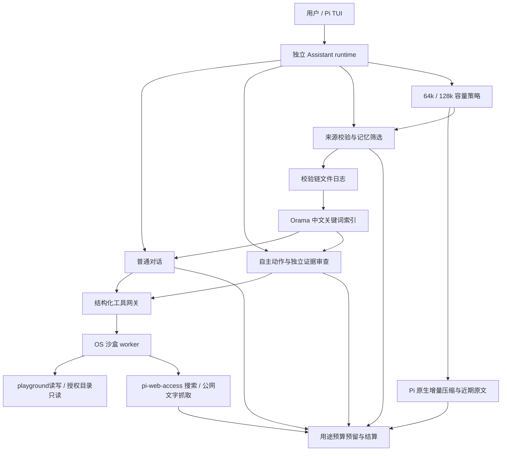

# Inner 非游戏改造与验证报告

日期：2026-11-03。入口为独立 TUI `pi-chat`。本轮实现已批准的长期记忆、64k/128k上下文策略、联网、读写、工具沙盒和分类预算；游戏测试按用户最新要求暂缓。无 GUI、桌面打包或定时器工作。使用方式见[助手 README](../../assistants/inner/README.md)。

## 实现结构

- `runtime.mjs`：公开 Pi SDK、独立 profile/会话、命令和事件集成。原有编程助手资源不加载；共享所选 auth，但不复制凭据。
- `memory-store.mjs`：有来源的事实、显式纠正、同源遗忘、日志恢复、中文关键词召回、长文待处理来源与原文补查。Orama/tokenizers 均锁定3.1.18。当前没有向量 embedding。
- `context-policy.mjs`：默认65536、可扩131072，受实际模型容量约束；87.5%标记、93%在安全空闲边界执行原生压缩。约半容量近期原文；细节型请求且预算充足时先扩一次。usage缺失时是字符估算，不能称为精确token计量。
- `budget.mjs`、`model-call.mjs`：调用前预留，按用途设置输出额度，未知消耗不归零；普通对话与后台分账。原生压缩的history/prefix调用分别保留输出额度，避免全局短回复上限截断摘要。
- `tool-gateway.mjs`、`tool-worker.mjs`：复用现有 sandbox-runtime 和已安装 pi-web-access 0.46.0 core。文件与网络工具均走受限worker，失败不回落未沙盒执行。主助手可信宿主不声称已整体OS隔离。
- `play-loop.mjs`：继续使用动作→实际证据→独立审查→继续/分享/休息，不固定探索步数和单条主动消息。新增只读相关记忆与受限公网资料。保留重复、取消、预算和600字符未回应文本门。

## 什么时候保存、压缩、回忆

明确“记住”或稳定偏好即时保存；常规用户消息累计约600字符时进行一次有界提取，压缩前也补做。每次最多五条，必须逐字引用来源，不能将虚构、猜测或单次要求自动升级为永久偏好。这个字符门槛是demo调度启发式，不是语义质量保证。

长消息按片段处理；保存待处理来源ID、原会话路径与hash，不在事件日志重复整段原文。重开后仅恢复已登记的助手自身会话来源，不扫描其他历史。一次压缩前只处理一个有界批次，余下继续待办，因此不能承诺即时提取所有细节。

记忆日志是真相来源，索引和core视图可重建；完整坏行或校验链损坏拒绝载入，未写完尾部可恢复。提取结果受版本检查，迟到提取不能覆盖纠正或复活遗忘。检索只注入少量完整事实，额外原文由memory_recall分页查询。

遗忘删除有效检索资格、同源记录并设置旧上下文屏障，原生压缩也排除这些历史。**原始磁盘会话仍保留，这是逻辑遗忘而非物理擦除。** 旧原型memories.json不自动迁入。

## 权限与联网边界

默认仅写playground和私有工具缓存；资料目录需用户显式只读授权，可撤销，权限改变即重启worker。拒绝配置凭据、软链接、路径越界、冲突覆盖和本地网络。实际内核探针验证了越界读、写与loopback拒绝。没有Shell、GUI、脚本执行或仓库克隆接口。

公网抓取为HTTPS文字、IPv4、无重定向、最多1MiB；拒绝本地、私网、内网域名、凭据URL、媒体及仓库克隆路径。本机fake-IP解析需要可信宿主的固定Cloudflare DoH broker：校验返回A记录后固定连接IP，TLS仍验证原域名。不放行私网、不改机器DNS。采用[Cloudflare官方JSON查询接口](https://developers.cloudflare.com/1.1.1.1/encryption/dns-over-https/make-api-requests/dns-json/)。搜索按次传递所需key，不传整份auth；查询是短公开主题，不自动上传私人聊天历史。

## 验证证据与实际边界

| 检查 | 结果与范围 |
| --- | --- |
| `python3 scripts/test.py` | 21个Node测试入口和pre-push Python检查全部通过；覆盖原回归及新增记忆/预算/压缩/实际沙盒 |
| 两种真实PTY布局 | 原助手链路和改造链路均验证fullscreen/regular；记忆保存、遗忘、重开、/new、真实SDK读写、64k显示 |
| 原生压缩 | 实际Pi SDK配可控模型，缩小近期保留窗口触发history/split-turn；检查多用途输出、截断失败不提交、遗忘不进入新摘要、重开 |
| 自主多次发言 | 可控模型验证5连续动作、3主动消息，以及重复/无推进停止；不代表真人体验 |
| 真实公网 | 真实搜索和抓取通过；一次完整TUI搜索/抓取后重开检查通过 |
| 真实模型TUI | 2次后台模型调用完成1个受审查动作；另1次普通聊天成功。为控制成本，探针额度主动停止，**本轮真实探针没有主动消息** |
| 固定版LSP | 本机固定版语言服务检查29个研究/扩展/助手模块，零诊断；细节见本机私有lsp.json |
| 冻结研究 | 原48场景未重新付费执行，公开证据复算通过；不填写人工偏好评分 |

离线测试使用可控模型，不代表真实模型在128k会话中的摘要质量、长期自然度或用户喜爱。尚未做真实128k满上下文质量实验。先前报告中的真实6动作/2主动消息属于上一阶段，不冒充本轮新工具版本的证据。游戏相关测试没有执行。

本机私有证据在 `outputs/inner-loop-integration/`（不入库）：`upgrade-real-tui.json`、对应log、请求账本与LSP输出。新增测试源码位于 `tests/inner-memory.mjs`、`inner-budget.mjs`、`inner-compaction.mjs`、`inner-sandbox.mjs`、`inner-upgrade-terminal.mjs`、`inner-upgrade-paid.mjs`。最后两个付费入口必须显式选择 `--web` 或 `--execute`，常规回归不调用付费服务。

## 费用与失败记录

后台默认扩为US$1、2048次、200万tokens，继续继承原研究119次、50,434tokens、US$0.04668，不重置。当前后台累计129次、51,111tokens、保守US$0.051759，后台余额约US$0.948241。普通聊天独立累计1次、1,085tokens、US$0.0006654；两类相加US$0.0524244。估算采用目录价格峰值的2倍，不是供应商账单。后台$1不是整个应用总费用上限。

本轮新增后台10次登记：3次真实搜索、5次免费抓取尝试、1次探索、1次审查；另1次普通聊天。搜索共预留US$0.0045。抓取失败也保留调用记录，不能将尝试次数当成功次数。

真实阻塞及处理：

- 最初依赖安装cwd错误，npm整理根依赖时移除六个SDK软链；立即恢复六个软链和.bin，改用绝对`--prefix`安装专属依赖，根运行回归通过。未提交机器依赖树。
- 本机fake-IP DNS导致抓取失败；使用固定DoH查询、原插件私网检查与连接IP固定，保持私网拒绝。
- sandbox wrapper覆盖TMPDIR，插件临时文件落到不可写位置；worker设置自身私有缓存TMPDIR，没有开放公共/tmp写权限。
- 真实PTY测试等待页脚不等于Pi已完成初始化，出现startup-in-progress；夹具改为等待公开InteractiveMode.init完成标记，避免输入竞态。
- 最后容量回归的mock账本漏了usd字段；补充真实结构，并验证预算紧张时不扩容。

未修改机器settings/sandbox配置，未混入token-confidence成果，未重建桌面，未处理定时器。提交和推送以git历史为准。
